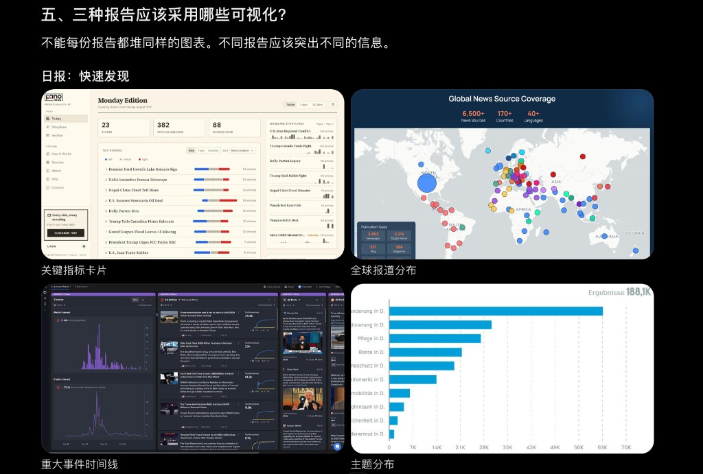
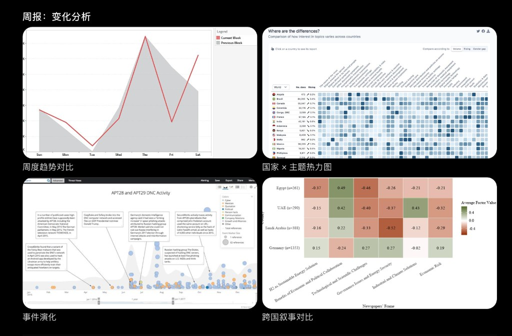
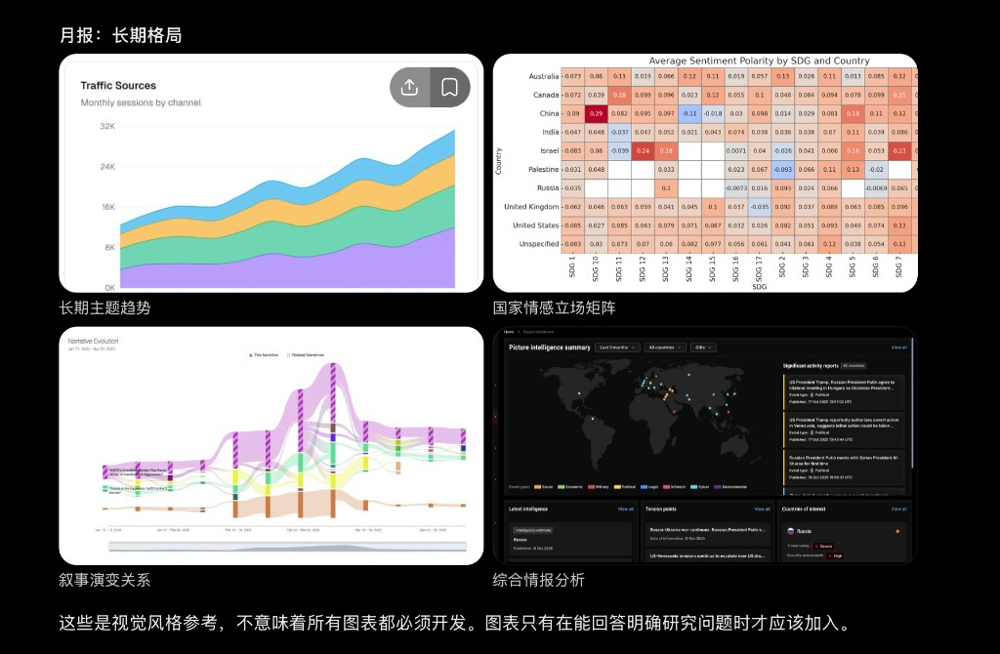

# GNI 三层情报报告产品（REPORT_PRODUCTS）

**版本：** report_products_v1  
**原则：** 日报 / 周报 / 月报是**三个不同层次的情报产品**，不是三种长度不同的新闻摘要。  
**共享底层：** 文章分析 → 事件指纹 → 指标与预警；数字由 SQL/规则计算，LLM 只写叙述。  
**口径：** 表述必须落在「被监测官媒样本」；禁止写成国家官方立场或民意。

详细规格：

- 日报 → [DAILY_REPORT_SPEC.md](DAILY_REPORT_SPEC.md)（`daily_report_schema_v2`）
- 周报 → [WEEKLY_REPORT_SPEC.md](WEEKLY_REPORT_SPEC.md)（实现后置）
- 月报 → [MONTHLY_REPORT_SPEC.md](MONTHLY_REPORT_SPEC.md)（实现后置）
- 治理 → [REPORT_GOVERNANCE.md](REPORT_GOVERNANCE.md)

---

## 1. 定位

| 产品 | 英文名 | 核心问题 | 主线 | 阅读时长 |
|------|--------|----------|------|----------|
| 每日情报 | Daily Intelligence Brief | 今天发生了什么？ | 重大事件 + 当日覆盖 / 情感立场 / 信号 | 3–5 分钟 |
| 每周分析 | Weekly Intelligence Report | 这一周发生了什么变化？ | 演化、跨国叙事差、周度变化 | 8–15 分钟 |
| 每月研判 | Monthly Strategic Review | 长期格局发生了什么变化？ | 趋势、国家画像、叙事格局、展望 | 15–30 分钟 |

| 维度 | 日报 | 周报 | 月报 |
|------|------|------|------|
| 分析对象 | 当日文章、事件 | 一周事件及其演化 | 长期事件、主题、叙事 |
| 关注重点 | 重要性、时效性 | 变化、对比、扩散 | 趋势、结构、持续性 |
| 事件分析 | 当日新事件与重要进展 | 事件发展过程 | 重大事件阶段性影响 |
| 国家比较 | 简要呈现 | 重点分析 | 深度比较 |
| 情感与立场 | 当日分布 | 周度变化 | 月度趋势 |
| 叙事分析 | 新出现的叙事信号 | 增强 / 减弱 / 转变 | 主导叙事与结构性变化 |
| 预警 | 当日重要预警 | 持续性异常 | 中长期风险信号 |
| 结论 | 今日重点 | 本周变化 | 本月研判 |

**核心价值：** 日报 = 及时发现；周报 = 解释变化；月报 = 理解长期趋势。

---

## 2. 共享流水线

```text
Raw News & Article Data
  → Structured Article Analysis（涉华片段、情感、立场、主题、框架、证据）
  → Event Intelligence Layer（指纹、聚合、时间线、跨国报道）
  → Analytics & Evidence Preparation（统计 + 证据筛选）
  → Daily / Weekly / Monthly Agent（不同深度与组织）
  → Report Validator
  → 报告中心 UI / 导出
```

| 环节 | 日报 Agent | 周报 Agent | 月报 Agent |
|------|------------|------------|------------|
| 数据输入 | 当日文章与事件 | 本周及历史对比 | 本月及历史趋势 |
| 统计 | 当日统计 | 周度变化 | 月度趋势 |
| 事件 | 新事件、重要进展 | 事件演化 | 重大事件回顾 |
| 国家 | 简要排名 | 国家间差异 | 国家画像变化 |
| 叙事 | 新叙事信号 | 叙事变化 | 叙事格局 |
| LLM | 摘要与事件解释 | 比较与综合 | 深度研判（不得改数字） |

三种时间必须分清：

- `published_at`：新闻发布时间  
- `event_time`：事件发生或宣布时间  
- `first_seen_at`：GNI 首次发现时间  

晚发现 ≠ 当日新发生的事件。

---

## 3. 点击下钻（报告 = 系统导航层）

| 结论类型 | 跳转 |
|----------|------|
| 事件标题 / 重大事件卡 | `/events/:id` |
| 预警条目 | `/alerts` |
| 国家名 / 分国结论 | `/countries?c=` |
| 议题量变化 / 趋势句 | `/trends` |
| 代表文章 | 原文 URL 或文章证据 |

报告不是孤立 PDF；结论必须能回到 Dashboard 对应分析页。

---

## 4. UI 可视化参考（风格参考，不强制一次做齐）

参考图仅说明信息架构与可读性目标；**无社媒数据则不做「公众兴趣」曲线**；无完整语言覆盖则不做虚假全球热力。

### 日报参考



宜对齐：KPI 卡、重大事件列表、主题分布；事件为主、文章为证据。

### 周报参考



宜对齐：周环比趋势、国家×主题热力、事件演化、跨国叙事对比。

### 月报参考



宜对齐：长期主题趋势、国家情感/立场矩阵、叙事演变、综合研判入口。

---

## 5. 开发优先级

1. **先做日报** — 验证事件聚合、证据引用、facts→叙述→UI 链路。  
2. **再做周报** — 验证环比、演化、跨国比较。  
3. **最后月报** — 依赖前两者数据积累与质量稳定。  

本仓库当前实现范围：**文档三层全写齐；代码只落地日报 v2**；周/月在报告中心占位。
