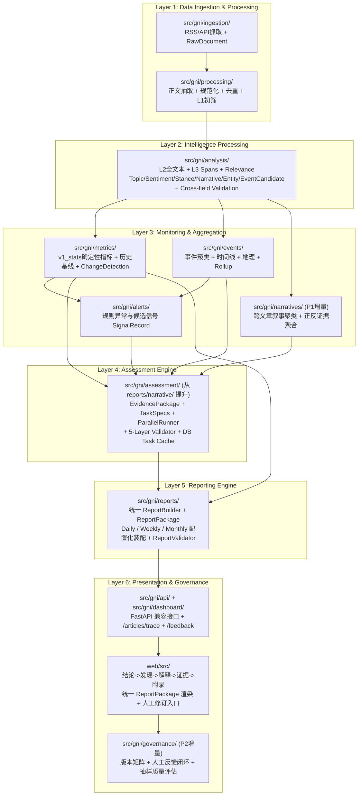

# GNI 目标系统架构设计（TARGET_ARCHITECTURE）

> 本文件将 **GNI V2.0 规范**的六层逻辑架构映射到当前真实仓库（模块化单体 `src/gni/` + `web/src/`），**不盲目拆微服务、不推翻现有目录、不为了架构美观创建空模块或大量独立 Agent**，而是以清晰的包边界、统一数据契约、严格依赖方向和可追溯治理闭环实现平滑演进。

---

## 1. 六层目标架构与实际代码包映射



---

## 2. 严格依赖方向约束

依赖方向**严格自上而下**，下层严禁导入上层（在 Phase 2 起通过 `tests/unit/test_imports.py` 增加静态 import 边界断言守护）：

```text
core / infrastructure (ORM & DB)
  <- ingestion / processing
  <- analysis (Article Intelligence)
  <- metrics / events / narratives / alerts (Monitoring & Aggregation)
  <- assessment (Evidence Package + Task Runner + Validator)
  <- reports (Daily / Weekly / Monthly ReportBuilder)
  <- api / dashboard / cli
  <- web/src (Frontend)
```

**必须消除的现有跨层反向依赖**：
1. `src/gni/reports/narrative/` 当前归属在 `reports/` 下且依赖 `daily.py`/`weekly.py`/`monthly.py` 的异构规则载荷字典 → 目标：抽离 `src/gni/assessment/`（`reports/narrative/` 保留 thin re-export 兼容层），让 `assessment` 只消费标准 `MetricSnapshot` + `Event` + `NarrativeCluster` + `SignalRecord` + `Article`。
2. `src/gni/alerts/rules.py` 直接拼装旧 `topics.primary` / `stances` → 目标：严格调用 `metrics/v1_stats.py` 与 `analysis/stance_util.py` 的 V1.0 读取器。
3. `src/gni/reports/daily.py`、`weekly.py`、`monthly.py` 各自重复查库与汇总 → 目标：下沉为 `src/gni/metrics/changes.py`（确定性变化检测）与 `src/gni/reports/builder.py`（共享组装底座）。

---

## 3. 核心契约体系总览（最小增量、向后兼容）

完整字段映射见 `DATA_MODEL_MAPPING.md`、`ASSESSMENT_MAPPING.md`、`REPORTING_MAPPING.md`，总览如下：

| 契约名称 | 物理落库 / 载体 | 核心约束 |
|---|---|---|
| **ArticleIntelligence** (`article_analysis_v1.1`) | `article_analyses.structured_result` + `article_china_spans` + `article_relevance_assessments` | 保留 `topics_v1`、`boards_v1`、`china_stance` 完全兼容 V1.0 统计；`china_stance` 强制显式化 `target="china_mainland"` 与 `expression_owner`（`media\|quoted_actor\|unclear`）；新增原文引句校验与 `quality` 块；P1 补齐 `narratives[]`、`entities[]`、`event_candidates[]` |
| **EventIntelligence** (`event_v1.0`) | `events` + `event_articles` + `event_locations` + `event_participants` + `event_metric_snapshots` + `event_revisions` | `event_time` 严禁以 `published_at` 替代；扩展 7 态演化状态与结构化时间线节点 |
| **NarrativeIntelligence** (`narrative_v1.0`) | 复用 `narrative_clusters` + `event_narrative_evidence`（最小增量扩展列/JSON） | 跨文章、跨事件表达框架聚合；显式区分 `supporting_evidence` 与 `counter_evidence` 及 `trend_status` |
| **MetricSnapshot** (`methodology_v1.0`) | `stat_snapshots` + 确定性变化检测输出 | **统计口径永久锁定**：去重 Article Count、4 板块×15 议题、3 类立场+Unclassified、Coverage Rate、`published_at`、`source_country`；新增 `ChangeCandidate`（含样本量保护与历史基线） |
| **EvidencePackage** (`evidence_v2.0`) | 内存构建 + `package_id`/`evidence_hash` 记录于 `report_narrative_tasks` | 任务定制切片、代表性+多样性+反例（事件/议题/全局三级）、结构化逐级 Token 预算瘦身（永不截断非法 JSON）、自动附带 `limitations[]` |
| **AssessmentResult** (`assessment_v2.0`) | `report_narrative_tasks.validated_output` | 基于 `NarrativeTaskOutput` 增量扩展：`finding_type` 支持 `Fact\|Inference\|Hypothesis\|Outlook`，补齐 `supporting_metrics[]`、`counter_evidence[]`、`alternative_explanation`、`alternative_scenario`；经 5 层校验器把关 |
| **ReportPackage** (`report_package_v2.0`) | `report_snapshots.payload`（兼容旧 `sections` 字典） | 日/周/月报统一顶层包结构，明确标注每章 `source_kind` 与 `status`，任务失败永不伪造研判 |

---

## 4. 关键架构决策记录（ADR）

### ADR-01：坚持模块化单体 + Task-based Assessment，拒绝多 Agent 膨胀
- **背景**：V2.0 规范明确要求“不为了架构完整而一次性增加大量 Agent 或数据库表”。
- **决策**：沿用 `TaskPromptSpec` + `runner.py` 统一任务编排引擎，将 9 类研判能力落地为可组合、可缓存、可单独重试的结构化 Task（日报 3 任务、周/月报 7 任务，其中 Signal 与 Outlook 在日报合并以控延迟，周/月报补齐独立 `narrative_analysis`）。
- **收益**：复用现有 `report_narrative_tasks` 缓存、预算统计与校验器，工程复杂度低且可观测性强。

### ADR-02：Stage 1 并行 + Stage 2 依赖的两阶段任务执行
- **背景**：实测串行执行日报 3 任务需 20.3s，周/月报 6 任务约 40–45s，接近反向代理 60s 超时风险。
- **决策**：在 `runner.py` 中将无相互依赖的态势/事件/议题/跨国/立场/叙事任务（Stage 1）通过受控线程池并发执行 LLM HTTP 请求（max_workers=3，不跨线程共享 SQLAlchemy Session），汇总后再执行依赖其结论的 `emerging_signals`（Stage 2），最后在主线程统一落库。
- **收益**：周/月报端到端耗时压降至 ~20s 内，无需引入 Celery/Redis 等重型队列。

### ADR-03：以 `StatSnapshot` 为唯一核心指标权威，收敛 `MetricRun` 双轨冲突
- **背景**：当前 `StatSnapshot`（V1.0）与 `MetricRun`（v0.4）并存，导致前端与预警出现口径打架。
- **决策**：所有报告核心 KPI、议题、立场、国家分布及情报预警统一以 `v1_stats.py` / `StatSnapshot` 为唯一事实来源；`MetricRun` 仅保留作为辅助指标（`weighted_article_volume`、采集成功率）的历史兼容层，禁止向报告核心表输出冲突议题或情感分数。

### ADR-04：版本隔离与非破坏性人工反馈闭环（Governance Loop）
- **背景**：当前本地库中 84.8% 的历史分析为 `v0.1` 旧版，且人工修订仅覆盖事件锁定/合并。
- **决策**：
  1. 在所有查询和报告覆盖率面板中显式展示 `v1_analysis_coverage_rate`（V1.0+ 有效分析占比），并支持按需 CLI 增量重跑（`gni analyze run --reanalyze-legacy`）而不破坏历史记录；
  2. P2 阶段引入单一轻量表 `analysis_feedback`（`target_type`, `target_id`, `field_path`, `original_value`, `revised_value`, `reason`, `operator`, `analysis_version`, `created_at`），严禁覆盖原始模型输出，同时为抽样质量评估（Precision/Recall/F1、证据覆盖率、人工认可度）提供金标数据源。
