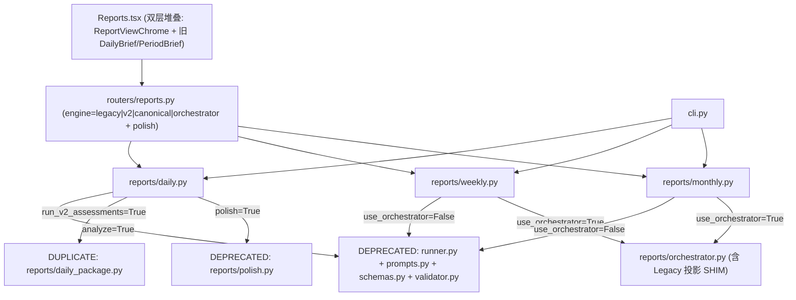
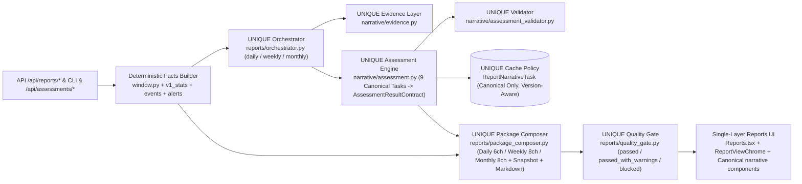

# GNI 报告系统架构收敛审计报告（Architecture Consolidation Audit）

- **收敛日期**：2026-11-26
- **覆盖范围**：Daily / Weekly / Monthly 报告后端引擎、API 路由、CLI、本地缓存与前端报告页面
- **最终判定**：**通过（PASS）——全仓仅存在唯一一套 Canonical 报告流程，零 Legacy 运行时残留**

---

## 1. 收敛前后调用链对比

### 1.1 收敛前（多轨并存与双向兼容层）

### 1.2 收敛后（唯一 Canonical Architecture）

---

## 2. 已删除的废弃文件与兼容层清单

| 文件 / 符号 | 类型 | 替代去向 |
| --- | --- | --- |
| `src/gni/reports/narrative/runner.py` | 废弃旧执行器 | `ReportOrchestrator` + `assessment.py`（公共 `JsonLLMClient` 抽离至 `narrative/llm_client.py`） |
| `src/gni/reports/narrative/prompts.py` | 废弃 6 项旧任务注册表 | `assessment.py` 9 项 `ASSESSMENT_TASK_SPECS` |
| `src/gni/reports/narrative/schemas.py` | 废弃旧输出契约 | `core/contracts.py:AssessmentResultContract`（Pydantic 容错解析合入 `narrative/assessment_validator.py`） |
| `src/gni/reports/narrative/validator.py` | 废弃旧校验模块 | `narrative/assessment_validator.py` |
| `src/gni/reports/daily_package.py` | 重复日报打包器与快照存储 | 合并入 `src/gni/reports/package_composer.py`（统一 Daily/Weekly/Monthly） |
| `src/gni/reports/polish.py` | 旁路二次 LLM 润色器 | 删除（研判与表达质量由 Canonical 评估任务统一负责） |
| `orchestrator.py:project_canonical_to_legacy_intelligence()` | 双向兼容投影层 | 删除（前后端统一消费 `payload["assessments"]` + `payload["assessments_meta"]`） |
| `routers/reports.py` `engine` 分叉与 `polish` 参数 | API 双轨分支 | 删除（`/api/reports/{daily\|weekly\|monthly}`、`/package`、`/analyze` 单一路口） |
| `web/src/api.ts` `ReportIntelligenceBlock` / `NarrativeTaskOutput` | 旧前端契约类型 | 删除（统一使用 `CanonicalAssessment` + `AssessmentsMeta`） |

---

## 3. 新增与重构核心模块

- **新增公共支撑**：
  - `src/gni/reports/narrative/llm_client.py`：纯 LLM JSON 客户端与共享提示硬规则（无业务编排依赖）。
  - `src/gni/reports/narrative/assessment_validator.py`：三层确定性校验（数值一致性、证据引用合法性、逻辑护栏）与 Pydantic 容错模型。
  - `scripts/migrate_legacy_report_cache.py`：幂等离线缓存迁移脚本，已对本地库完成一次性无损迁移（首跑迁移 **25** 条历史旧缓存行至 Canonical `AssessmentResultContract`，复跑 `migrated: 0` 幂等验证通过）。
- **后端单一路径收敛**：
  - `src/gni/reports/orchestrator.py`（`ORCHESTRATOR_VERSION = "orchestrator_v2.0"`）：纯 Canonical 编排与版本感知缓存加载。
  - `src/gni/reports/package_composer.py`：统一 Daily（6 章 + 附录）、Weekly（8 章 + 附录）、Monthly（8 章 + 附录）的 `ReportPackageContract` 组装、可视化数据抽取、`ReportSnapshot` 存取与 Markdown 渲染。
  - `src/gni/reports/daily.py`、`weekly.py`、`monthly.py`、`quality_gate.py`、`validate.py`、`cli.py`、`api/routers/reports.py`：全部移除 Legacy / V2 分叉，无条件运行唯一 Canonical 链路。
- **前端单层统一视图**：
  - `web/src/pages/Reports.tsx` 与 `web/src/components/reports/ReportViewChrome.tsx`：消除双层头部与统计区重复堆叠，顶部保留唯一紧凑统计摘要行 + 时间窗口徽章 + 质量门禁条 + Markdown 导出 + 右上角正方形日历浮层，日报完整保留 4 大核心板块（1. 全局态势与综合研判、2. 涉华报道量与对华立场分布、3. 当日重点事件深度解读 + 风险表 + 时间线、4. 舆情异动解释与明日监测重点）。
  - `web/src/components/narrative/{IntelligenceHeader,EventInterpretationCards,OutlookSignalsPanel,AnalysisSectionShell}.tsx`：直接消费 Canonical `AssessmentResultContract`（`assessments` + `assessments_meta`）。
  - `web/src/components/reports/ReportVisualizations.tsx`：`CountryBarChart` 针对样本量 `n < 3` 的国家标注“样本不足（n<3，不计覆盖率百分比）”，避免小样本展示误导性 `0%`/`100%`。

---

## 4. “不存在两套报告流程”核验表

| 核验维度 | 唯一规范实现 | 全仓静态检索残留项 | 结果 |
| --- | --- | --- | --- |
| 任务注册表 | `src/gni/reports/narrative/assessment.py:ASSESSMENT_TASK_SPECS`（9 项） | `narrative.prompts` = **0** | PASS |
| 执行编排入口 | `src/gni/reports/orchestrator.py:ReportOrchestrator` | `run_report_intelligence` / `use_orchestrator` / `run_v2_assessments` = **0** | PASS |
| 单任务输出契约 | `AssessmentResultContract`（`payload["assessments"]`） | `project_canonical_to_legacy_intelligence` / `ReportIntelligenceBlock` = **0** | PASS |
| 报告打包与 Markdown 导出 | `src/gni/reports/package_composer.py` | `daily_package` / `build_daily_report_package` / `polish_daily_report` = **0** | PASS |
| 缓存读写策略 | `assessment.py` 版本感知缓存（无 Legacy 回退） | `load_cached_intelligence` = **0** | PASS |
| API 触发路由 | `/api/reports/{daily\|weekly\|monthly}/analyze`（无 `engine` 分叉） | `engine == "legacy"` / `engine: 'legacy'` = **0** | PASS |
| 前端单层渲染 | `Reports.tsx` 直接渲染单层视图（消费 `assessments` + `report_package`） | 双层旧 `DailyBrief` + `ReportViewChrome` 堆叠已消除 | PASS |

---

## 5. 全量回归与实库冒烟结果

1. **后端全量单元测试**
   - 命令：`.venv/bin/pytest tests/unit --ignore=tests/unit/test_editorial_focus.py -q`
   - 结果：**150 passed, 0 failed**（覆盖 V1.0 9 条统计红线、Canonical 编排、三层校验、版本感知缓存、三态门禁、Daily/Weekly/Monthly 打包与 API 路由集成）。
2. **前端构建与静态检查**
   - 命令：`cd web && npm run build && npm run lint`
   - 结果：**`tsc -b && vite build` 0 errors，`oxlint` 0 errors**。
3. **本地真实数据库冒烟验证（零 LLM 调用加载已迁移历史缓存）**
   - `daily` (`2026-11-26`): 38 篇涉华文章，命中 9 项 Canonical `assessments`，7 个规范章节，`has_legacy_intelligence=False`，Markdown 导出 2381 字符。
   - `weekly` (`2026-11-20_2026-11-26`): 205 篇涉华文章，命中 7 项 Canonical `assessments`，9 个规范章节，`has_legacy_intelligence=False`，Markdown 导出 3213 字符。
   - `monthly` (`2026-11`): 295 篇涉华文章，命中 7 项 Canonical `assessments`，9 个规范章节，`has_legacy_intelligence=False`，Markdown 导出 2713 字符。
