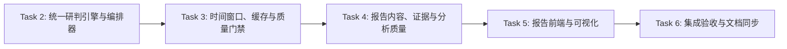

# 下阶段报告系统重构实施计划（Next Report Refactor Plan）

> 本计划严格按依赖顺序对应 `00_执行总说明.md` 中的 Task 2 ～ Task 6。每个阶段完成后单独提交并暂停人工审核，不一次性重写。

## 阶段总览与依赖顺序

## Task 2：统一研判引擎与编排器（`02_统一研判引擎与编排器.md`）
- **核心改动**：
  - 新增统一编排器 `src/gni/reports/orchestrator.py` 与 `ReportTaskProfile` 配置。
  - 将 Weekly / Monthly 迁移至 Canonical Assessment Engine（通过 `report_type` 参数化 prompt，不复制代码），消除 `event_analysis` 同名冲突。
  - 保留 `project_canonical_to_legacy_intelligence()` 兼容投影，确保现有前端零破坏。
- **验收标准**：Daily/Weekly/Monthly 全部走统一编排器；`/api/reports/{daily|weekly|monthly}/analyze` 行为一致；现有 12 个报告单测全绿 + 新增编排器单测。

## Task 3：时间窗口、缓存与质量门禁（`03_时间窗口缓存与质量门禁.md`）
- **核心改动**：
  - 统一 `WindowResolver`：显式标注 `window_mode`（`calendar_day` / `rolling_7d` / `calendar_month` / `rolling_30d`）；修复自然月月中不完整月份对比（`is_partial_period` + MTD 同天数对齐）。
  - 完善缓存键：将 `model_version`、`schema_version`、`methodology_version`、`taxonomy_version`、`evidence_hash` 纳入缓存命中与失效判定（提供数据库迁移脚本与回滚方案）。
  - 强化三层校验器门禁，防止 `event_time` 被 `published_at` 替代或编造统计数字。
- **验收标准**：变更模型或方法论版本后自动失效缓存；月中自然月对比公平且显式标注；新增边界与缓存失效单测全绿。

## Task 4：报告内容、证据与分析质量（`04_报告内容证据与分析质量.md`）
- **核心改动**：
  - 为 Weekly / Monthly 补齐 `ReportPackageContract` 组装与 Markdown 导出（`/api/reports/{weekly|monthly}/package`）。
  - 强化“数据发现—解释—证据—反证/局限—观察项”五段链条，去除重复 KPI、重复结论与挤占正文的文章列表。
  - 输出确定性图表数据结构（趋势序列、议题增量、立场分布、国别对比）。
- **验收标准**：三类报告均通过契约校验与真实数据抽检；无运维噪声混入正文。

## Task 5：报告前端与可视化（`05_报告前端与可视化.md`）
- **核心改动**：
  - 更新 `web/src/pages/Reports.tsx` 与可视化组件，消费统一的 `ReportPackageContract` 与图表数据，渲染趋势图/立场分布图/议题变化图。
  - 保留并优化右上角正方形日跳月日历（`ReportCalendarPopover`）与三类报告联动。
  - 清理已废弃的 `DailyReportPackageView.tsx` 死代码（待统一视图上线后）。
- **验收标准**：`npm run build && npm run lint` 0 error；三类报告章节清晰、图表正确渲染、无原始 JSON 暴露。

## Task 6：集成验收与文档同步（`06_集成验收与文档同步.md`）
- **核心改动**：
  - 运行全量后端 pytest、前端 build/lint 及真实数据端到端冒烟验证。
  - 同步更新 `docs/REPORT_PRODUCTS.md`、`docs/DAILY_REPORT_SPEC.md`、`docs/WEEKLY_REPORT_SPEC.md`、`docs/MONTHLY_REPORT_SPEC.md`。
- **验收标准**：全量测试通过、文档与真实代码 100% 一致。

## 主要风险与缓解
- **历史缓存兼容风险**：缓存表扩展字段时使用可空列 + 默认值迁移，并提供降级回滚 SQL，不删除已有历史记录。
- **LLM 成本与延迟风险**：通过 `ReportTaskProfile` 分级启用任务（Daily 默认核心 5 任务，零数据日短路），并复用单次 `EvidenceBundle`。
