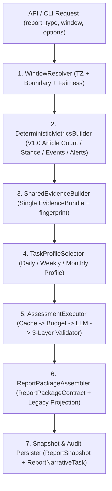

# 统一报告编排器设计（Report Orchestrator Design）

## 1. 设计目标

用单一、确定性的 `ReportOrchestrator` 取代当前分散在 `daily.py`、`weekly.py`、`monthly.py`、`runner.py`、`assessment.py` 中的多套调用逻辑，同时严格遵守“监测（确定性统计）→ 研判（Canonical Assessment）→ 报告组装（Report Package）”三层分离原则。

## 2. 架构与数据流

## 3. 核心阶段与职责边界

### 阶段 1：`WindowResolver`（周期解析）
- 统一在 `Asia/Shanghai`（可配置 `GNI_REPORT_TIMEZONE`）解析时间窗口，输出不可变 `ReportWindowSpec`：
  - `report_type`, `period_id`, `window_mode`（`calendar_day` / `rolling_7d` / `calendar_month` / `rolling_30d`）
  - `start_utc`, `end_utc`, `prev_start_utc`, `prev_end_utc`
  - `is_partial_period: bool`、`comparable_prev_start_utc` / `comparable_prev_end_utc`（解决月中不完整月份对比失真）。

### 阶段 2：`DeterministicMetricsBuilder`（确定性事实层）
- 仅由 SQL/Python 计算，严禁 LLM 介入：
  - V1.0 统计（`run_v1_stat_snapshots`）：Global / Country / Board / Topic 唯一文章数、正/中/负计数与比例、`unclassified_count`、`stance_coverage_rate`。
  - 历史序列（Daily 7d 基准、Weekly 近 4 周、Monthly 近 6 月）、多因素变化信号（`metrics/changes.py`）、重点事件（`events`）、叙事聚类（`narratives`）、预警信号（`alerts`）。

### 阶段 3：`SharedEvidenceBuilder`（统一证据包）
- 每个报告周期只构建一次主 `EvidenceBundle` 及确定性 `evidence_hash`（基于规范化 JSON 排序后的 SHA-256），再按任务需求裁剪出 `EvidencePackageContract`，避免重复查询数据库。

### 阶段 4 & 5：`AssessmentExecutor`（单引擎受控执行）
- 按 `ReportTaskProfile` 确定的顺序执行任务（见 `REPORT_TASK_PROFILES.md`）：
  1. **缓存命中检查**：基于完整复合缓存键（见 `REPORT_TIME_WINDOW_AUDIT.md`）；`force=True` 或指定 `tasks=[...]` 时跳过对应任务缓存。
  2. **零样本/低样本短路**：`is_insufficient_data=True` 时直接产出确定性 `insufficient_data` 结果，不调用 LLM。
  3. **预算与熔断守卫**：调用 `llm_allowed()`；超预算或无 API Key 时优雅降级为 `degraded` 确定性摘要。
  4. **三层校验器**：JSON Schema → 数值一致性校验（禁止编造数字）→ 证据引用与 Fact/Inference 分类校验；校验不通过标记 `needs_review` 并记录 `validation_result`，不静默覆盖。

### 阶段 6：依赖顺序与错误处理
- **执行顺序**：基础事实型任务（`event_analysis`, `topic_analysis`, `country_comparison`, `sentiment_stance_analysis`, `change_detection_assessment`, `narrative_analysis`）先执行；综合型任务（`overall_situation_assessment`, `risk_signal_assessment`, `outlook_assessment`）可引用前置任务摘要作为辅助上下文（不依赖其修改统计数字）。
- **部分失败隔离**：单个任务超时或 JSON 解析失败仅标记该任务 `status="failed"`，不阻塞其余任务与报告整体组装；汇总状态按 `completed` / `needs_review` / `partial` / `failed` / `rule_only` 准确上报，支持按 `tasks=[failed_task]` 局部重试。
